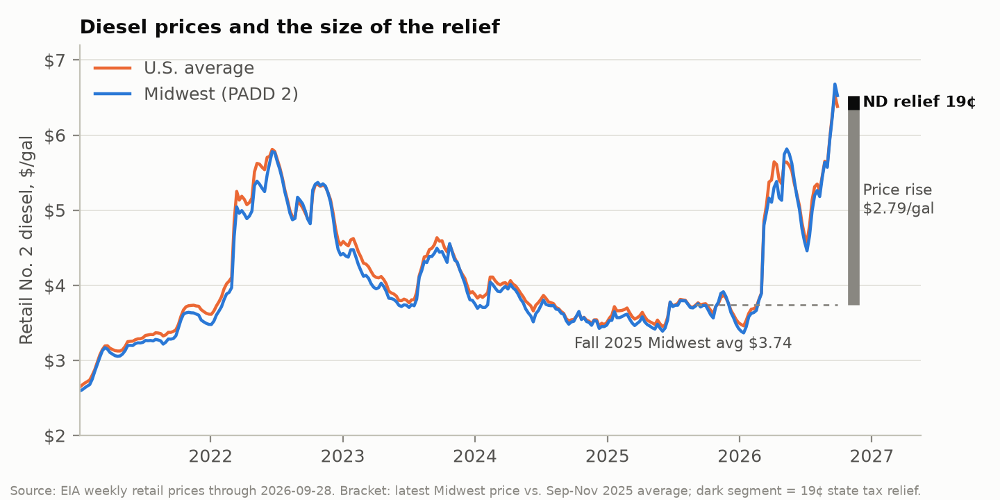

## Bottom line

Executive Order 2026-08 lets licensed vehicles hauling for agriculture burn red-dyed diesel on North Dakota roads through Nov. 30. The benefit is the difference in state tax, 19¢ a gallon. The federal 24.4¢ tax is untouched. Hauling this fall's corn, soybean and wheat crops takes about **4.8 million gallons** of truck diesel. If every eligible truck switches, farmers save about **$0.9 million**. If only trucks already fueled from farm tanks switch, they save about **$0.5 million**. That money comes out of state road funds and works out to **about 3–5¢ per acre**. Diesel is up about $2.80 a gallon since last harvest, so the order offsets **under 1%** of the higher fuel bill ND farms face this fall. Grain prices are set in world markets, so the savings stay with farmers, not consumers. The biggest risk is federal: without an IRS waiver, running dyed fuel on a public road is still a federal violation with a $1,000-minimum penalty. The order is fast, cheap and well aimed, but it is small, and its legal footing for farmers is incomplete.

## What the order does, and what it doesn't

North Dakota taxes clear diesel at 23¢ a gallon. Dyed diesel sold for farm, industrial or railroad use pays 4¢, and state law bars it from the tank of any licensed vehicle (NDCC §57-43.2-41). The order suspends that ban, and the $500–$10,000 administrative fees that enforce it, for licensed vehicles used for "agricultural purposes" or for moving grain, livestock, feed, seed, fertilizer, equipment and other farm inputs and products. The governor's office says the savings are 19¢ a gallon.

Three details matter more than the headline:

- **Federal tax still applies.** The governor's release says the order "does not affect the federal government's 24.4-cent-per-gallon excise tax." Dyed fuel in a highway vehicle remains a federal violation (26 U.S.C. §6715; penalty the greater of $1,000 or $10 a gallon), and the IRS tells farmers not to use it on the highway "even though the highway use is in connection with farm business." As of Sept. 30 there was no IRS relief for North Dakota; five other states have asked, and North Dakota's announcement does not say it has. When the IRS has granted relief before, it waived the *penalty* but still collected the 24.4¢. So the order is worth 19¢ a gallon, never 43¢.
- **The state tax is waived by non-enforcement, not by name.** The order suspends the ban and the fees, but Section 8 says it does not "suspend, waive, or alter any state or federal tax" unless it says so, and it never names the 23¢. The practical result is almost surely the advertised 19¢; a line from the Tax Commissioner would remove the doubt.
- **Eligibility is broader than "farmers."** On its face a commercial truck hauling grain or fertilizer qualifies too. The order is silent on recordkeeping, IFTA carriers and interstate trips, and ND has no existing farm-truck refund that would have covered these gallons anyway.

Neighbors did less. South Dakota's order (EO 2026-11) raises harvest weight limits 10% but keeps dyed fuel off roads, and Minnesota had not acted as of Sept. 30. Nebraska, Louisiana, Alabama, Texas, Oklahoma, Arkansas and Indiana took similar dyed-diesel steps; Georgia instead suspended its fuel tax for everyone.

## How big is it?

We estimate the savings with five numbers from public data, for the three crops that make up most fall hauling:

> savings = tons hauled to market this fall × gallons per ton × 19¢, where gallons per ton = 2 × one-way miles ÷ mpg ÷ tons per load

1. **2026 production:** NASS forecasts 578 million bushels of corn, 204 million of soybeans and 282 million of spring wheat and durum.
2. **Share hauled off the farm this fall:** 43% of corn, 60% of soybeans and 10% of wheat. From NASS Grain Stocks, 2024–25: crop not in on-farm storage on Dec. 1 (wheat: the fall drop in on-farm stocks, scaled to 63 days).
3. **Haul distance:** about 27.8 miles one way for corn and soybeans and 24.5 for wheat (UGPTI farm truck survey).
4. **Load size:** about 22 tons, weighting each truck type's load by its share of ND grain hauling (UGPTI).
5. **Fuel economy:** 6.2 mpg for heavy trucks (ORNL).

That gives 4.8 million gallons and $0.90 million if every eligible truck switches: corn $557K, soybeans $290K, wheat $58K.

**Not every truck will switch.** In USDOT's 2021 truck survey, 53% of heavy farm trucks refuel mainly from their own tanks. If only those switch, savings are about $0.5 million. Federal penalty exposure will hold some farmers back, too.

**What moves the estimate.** Haul distance matters most. Across the UGPTI survey's range of North Dakota trips (21.7–41.7 miles), the all-switch figure runs $0.7–1.4 million. The estimate leaves out sugarbeets, potatoes, field-to-bin trips, livestock and fertilizer hauling, and pickups. A fuller model that includes most of these, and assumes 53% take-up, gives $0.6 million.

**Exhibit 1. Estimated size of the order, Sept. 29–Nov. 30, 2026**

| | Only farm-tank trucks switch (53%) | Every eligible truck switches |
|----------------------------------------|--------------------:|--------------------:|
| Gallons switched to dyed fuel | 2.5 M | 4.8 M |
| Savings = state revenue forgone (19¢/gal) | $0.5 M | $0.9 M |
| Average per ND farm (25,068 farms) | $19 | $36 |
| Per acre of corn, soybeans and wheat | 3¢ | 5¢ |
| Per bushel hauled | 0.12¢ | 0.22¢ |
| Share of the higher fall diesel bill on corn and soybean harvest plus hauling | 0.4% | 0.7% |

*Corn, soybeans and wheat; trucks only. Haul distance moves the right-hand column from $0.7 million to $1.4 million. The bottom row uses 44 million gallons (combine and grain-cart fuel for this year's corn and soybeans, plus the truck gallons) and a $2.79/gal price rise.*

Diesel is up about $2.79 a gallon since last fall (Exhibit 2); on a qualifying gallon the order returns 7% of that. Most farm diesel doesn't qualify, because tractors and combines already burn dyed fuel. Across the roughly 44 million gallons it takes to harvest and haul this year's corn and soybeans, the order covers under 1% of the extra cost.

Take a 2,000-acre corn and soybean farm at this year's forecast yields with its own dyed-fuel tank. Hauling this fall's share of its crop burns about 900 gallons. If it switches all of that, the order saves it about **$170**. Its harvest diesel bill, combines included, is up about **$22,000**.

{width=100%}

## Who benefits

**Farmers keep it.** Agriculture Commissioner Goehring said the savings will "hopefully be passed on to the consumer." They won't be. ND grain is priced off Chicago futures minus a local basis, and a one-season cost cut of about 0.2¢ per bushel hauled cannot move a world price or a grocery shelf. It is too small to show up in elevator basis bids, so the savings stay with whoever buys the fuel.

**Commercial haulers** qualify on paper, but few will switch: they typically fuel at card-lock sites that sell clear diesel, many file IFTA returns, and they carry the same federal exposure.

**Border farms lose out.** A farm hauling from Richland or Sargent County into a South Dakota or Minnesota elevator cannot legally cross the line on dyed fuel, so the reader who farms two miles from South Dakota is right. Statewide the loss is a few percent of gallons; for those farms it is everything.

**Non-farm drivers are excluded by design.** The alternatives below price the other option.

## Tradeoffs

**Deadweight loss is close to zero.** Grain has to move whatever diesel costs; short-run diesel demand elasticities for U.S. trucking are near zero (Dahl 2012; Winebrake et al. 2015). The order changes which tank farmers fill from, not how far they drive, so it is close to a lump-sum transfer.

**It waives the road charge when road costs peak.** Pavement damage rises roughly with the fourth power of axle weight, so a loaded 80,000-lb grain semi is the most road-intensive vehicle most township roads see. Even at the full 23¢, a loaded semi pays about 4.5¢ a mile in state fuel tax. FHWA's cost allocation work puts pavement cost for that truck on rural *interstates* at roughly 25–40¢ a mile in today's dollars. The order cuts that to under 1¢ a mile, and gravel and township roads fare worse. In dollars this is minor: $0.5–0.9 million against UGPTI's estimated $618 million a year in local road needs. The principle is not minor. Nearly 40% of the forgone revenue would have gone to counties, cities and townships (NDCC §54-27-19).

**Enforcement gets harder, briefly.** A trooper can't tell a farm-errand pickup from a personal one, so some fuel will leak, though at 19¢ a gallon little is at stake. The flip side is a real strength: about half of heavy farm trucks already fuel from farm tanks, so the order needed no forms, no appropriation and no new systems.

**Precedent.** Each emergency suspension makes the next easier to justify for a smaller shock.

## Better or complementary options

- **Ask the IRS for dyed-fuel penalty relief.** It costs nothing, five states already have, and it removes the largest legal risk left on farmers (though users would still owe the 24.4¢).
- **Issue Tax Commissioner guidance.** It should confirm that the 23¢ tank-capacity assessment will not be collected, and state what records to keep and how IFTA carriers and interstate trips are treated. Nebraska's FAQ is a model.
- **Refund the tax on documented ag hauling instead** (Nebraska's Form 84AG). Same cost, no federal exposure because trucks keep burning legal clear fuel, and it covers border farms' in-state miles. The costs are paperwork, slower money, and a statute ND doesn't have.
- **Coordinate with South Dakota and Minnesota.** Reciprocal recognition would fix the border problem. South Dakota's governor said he is reviewing further steps.
- **A diesel tax holiday for everyone.** This answers the non-farm commenters and avoids the dyed-fuel legal problems. Suspending the 23¢ on all highway diesel for the same two months would cost about **$14 million**, 15 to 30 times as much, and most of it would go to trucking and oilfield traffic.
- **Per-acre payments.** At the order's cost, about 2–4¢ an acre.
- **Do nothing.** This saves about $0.5–0.9 million; farmers would still carry over 99% of the price shock, as they do under the order.

## Why couldn't farmers always do this?

Dyed diesel is ordinary diesel with a red marker meaning "no road tax paid." Fuel taxes charge road users roughly in proportion to how much they drive. Tractors and combines mostly stay off public roads, so their fuel is exempt, and the dye lets troopers and IRS agents check with a dipstick that untaxed fuel stayed off the highway. Farm trucks use public roads, heavily, so their fuel is taxed like everyone else's. The rule is federal as well as state, which is why a governor can waive North Dakota's penalty but not Washington's.

## Methods and sources

- **Savings estimate (five parameters).**
  - NASS Crop Production (Sept. and Aug. 2026) and NASS Grain Stocks (2024–26) give production and the share hauled off the farm.
  - The UGPTI farm truck survey (DP-284) and UGPTI Infrastructure Needs 2024 give haul distance and load size.
  - The ORNL Transportation Energy Data Book gives fuel economy.
  - USDOT's 2021 Vehicle Inventory and Use Survey gives the 53% of trucks fueled from farm tanks.
- **Context.** University of Minnesota field-operation fuel use, the 2022 Census of Agriculture, FHWA *Highway Statistics* 2024, and EIA weekly retail diesel. AAA figures are as reported by InForum.
- **Law.** EO 2026-08 and the governor's release; NDCC chs. 57-43.2 and 54-27; 26 U.S.C. §§4082, 6715; IRS Pubs. 225 and 510; IR-2024-265.
- **Details.** `simple_estimate.docx` and the appendix give the parameter table, the calculation and the sensitivity checks. The appendix also describes the fuller model used as a cross-check. The README lists what we could not verify.
