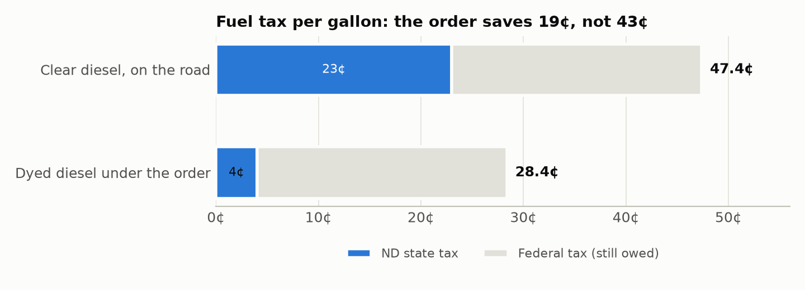
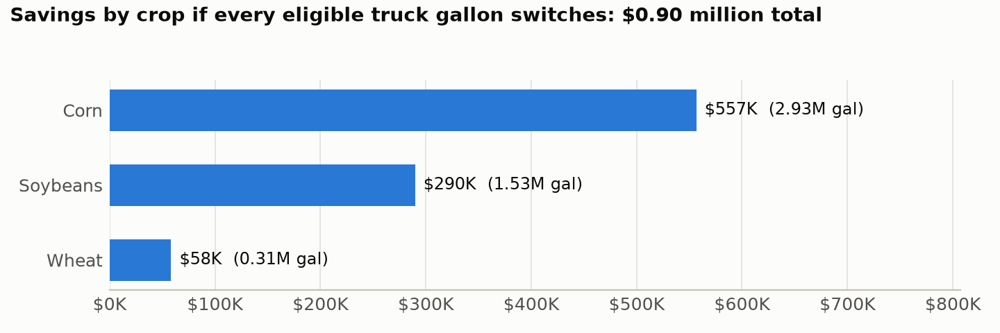
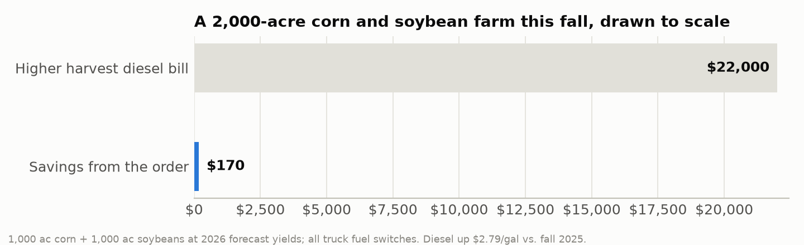
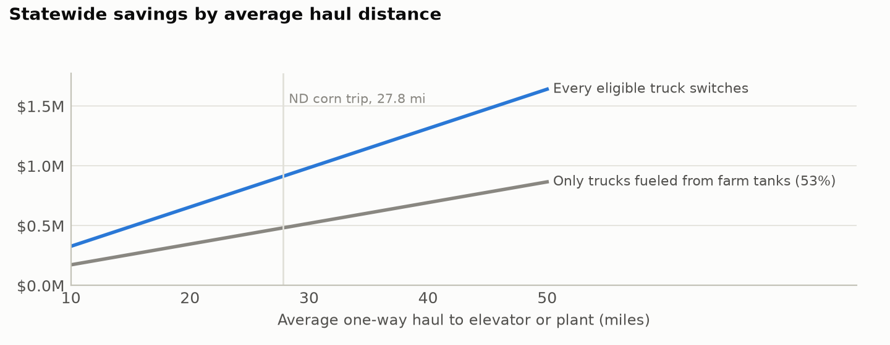

On Sept. 29, Gov. Kelly Armstrong signed [Executive Order 2026-08](https://www.governor.nd.gov/sites/default/files/documents/Executive%20Order%202026-08%20Diesel%20emergency.pdf). Through Nov. 30 it lets licensed vehicles hauling farm products run red-dyed diesel on North Dakota roads. Here is what that is worth, estimated with five numbers from public data.

## The starting point: 19¢ a gallon

- **19¢ saved per gallon.** North Dakota taxes clear diesel at 23¢ a gallon and farm dyed diesel at 4¢ ([NDCC 57-43.2](https://ndlegis.gov/cencode/t57c43-2.pdf)).
- **24.4¢ still owed.** The order doesn't touch the federal tax ([governor's release](https://www.governor.nd.gov/news/armstrong-declares-diesel-emergency-takes-action-provide-relief-fuel-costs-agricultural)). The governor's order covers state penalties only; until the IRS grants relief, a truck caught with dyed fuel on a public road faces a federal penalty of $1,000 or $10 a gallon, whichever is greater ([26 U.S.C. §6715](https://www.law.cornell.edu/uscode/text/26/6715)).
- **$2.79 a gallon: the price rise since last harvest** ([EIA](https://www.eia.gov/dnav/pet/xls/PET_PRI_GND_DCUS_R20_W.xls)). The 19¢ covers 7% of that on a gallon that qualifies.

{width=72%}

## The estimate: five numbers

Tractors, combines and grain carts already run on dyed fuel, so the order only helps trucks hauling crops on public roads. We count corn, soybeans and wheat, which make up most of that hauling:

> **savings = tons hauled to market this fall × gallons per ton × 19¢**
>
> gallons per ton = 2 × one-way miles ÷ miles per gallon ÷ tons per load

| | Corn | Soybeans | Wheat | Source |
|-------------------------------|------:|------:|------:|------------------------------------|
| **1. 2026 production (million bu)** | 578.5 | 203.7 | 282.4 | [NASS Crop Production](https://esmis.nal.usda.gov/sites/default/release-files/796056/crop0926.pdf), Sept. 2026 |
| **2. Share hauled off the farm this fall** | 43% | 60% | 10% | [NASS Grain Stocks](https://esmis.nal.usda.gov/publication/grain-stocks), 2024–25 |
| **3. One-way haul (miles)** | 27.8 | 27.8 | 24.5 | [UGPTI farm truck survey](https://www.ugpti.org/resources/reports/downloads/dp-284.pdf) |
| **4. Tons per load** | 21.5 | 21.7 | 22.0 | UGPTI survey and [UGPTI 2024](https://www.ugpti.org/resources/reports/downloads/2024-10-infrastructure-needs.pdf) |
| **5. Truck fuel economy (mpg)** | 6.2 | 6.2 | 6.2 | [ORNL Transportation Energy Data Book](https://tedb.ornl.gov/) |
| Tons hauled (million) | 7.02 | 3.70 | 0.86 | (1) × (2) |
| Gallons per ton | 0.418 | 0.413 | 0.360 | 2 × (3) ÷ (5) ÷ (4) |
| **Gallons (million)** | **2.93** | **1.53** | **0.31** | |
| **Savings at 19¢** | **$557K** | **$290K** | **$58K** | **Total $0.90 million** |

**How the share hauled is measured.**

- *Corn and soybeans:* one minus the share of the crop still in on-farm storage on Dec. 1.
- *Wheat:* harvested in August, so we use how much on-farm stocks fell from Sept. 1 to Dec. 1, scaled to the order's 63 days.
- Both are averaged over 2024 and 2025.

{width=80%}

## What it adds up to

- **About $0.9 million** in state tax saved on **4.8 million gallons**, *if every eligible truck switches.*
- **About $0.5 million** if only trucks already fueled from farm tanks switch. That is 53% of heavy farm trucks in USDOT's 2021 [Vehicle Inventory and Use Survey](https://www.census.gov/programs-surveys/vius.html). Federal penalty risk may hold some farmers back, too.
- **About $36 per ND farm, 5¢ per acre of corn, soybeans and wheat, 0.22¢ per bushel hauled.** That is too small to show up in elevator bids or grocery prices.
- **0.7% of the higher fall fuel bill.** Combines and grain carts burn about 39 million gallons harvesting this year's corn and soybeans ([UMN](https://wlazarus.cfans.umn.edu/) fuel per acre × NASS acres). The trucks add 4.8 million. At $2.79 more per gallon, that is $122 million in extra cost.
- **The road fund gives it up.** The money would have gone to the Highway Tax Distribution Fund; nearly 40% of that goes to counties, cities and townships ([NDCC 54-27-19](https://ndlegis.gov/cencode/t54c27.pdf)).

**One farm.** Take 1,000 acres of corn and 1,000 of soybeans at this year's forecast yields. Hauling this fall's share of the crop burns about 900 gallons, so the order saves about **$170**. Its combines and grain carts burn about 6,920 gallons. Together, its harvest diesel bill is up about **$22,000**.

{width=80%}

## How sure are we?

Haul distance matters most. The UGPTI survey's North Dakota trips range from 21.7 miles (semis hauling wheat) to 41.7 miles (the second-choice delivery point). Over that range savings run from $0.7 million to $1.4 million. Each of the other inputs moves the total by about $0.2 million or less:

- 2024 vs. 2025 storage patterns: $0.89M–0.92M.
- An all-semi fleet vs. a fleet weighted by truck count: $0.74M–0.99M.
- 5.1 vs. 6.2 mpg: $0.90M–1.10M.

We also leave some hauling out: sugarbeets, potatoes and other crops, trips from field to bin, livestock and fertilizer, and pickups. The project's fuller model puts the excluded truck hauls at about 2 million more gallons.

{width=80%}

## Three more numbers

- **26%:** share of ND cropland in counties bordering Minnesota or South Dakota ([Census](https://www.nass.usda.gov/Publications/AgCensus/2022/Full_Report/Volume_1,_Chapter_2_County_Level/North_Dakota/)). Neither state allows dyed fuel on its roads, so farms delivering across the line get nothing ([South Dakota's order](https://drgnews.com/2026/09/29/governor-rhoden-provides-flexibility-for-farmers-at-harvest/) raised weight limits instead).
- **$14 million:** cost of suspending the 23¢ on *all* highway diesel for the same two months. That is 59 million gallons × $0.23 ([FHWA](https://www.fhwa.dot.gov/policyinformation/statistics/2024/)), about 15 times the order's cost.
- **$0:** cost of asking the IRS for penalty relief, as five other states have. It wouldn't save farmers money, since the 24.4¢ would still be owed, but it would remove their legal risk.

## Data and code

Every number comes from `analysis/simple_estimate.py`, run on public data in the project folder.

- `data/raw/` holds each source file, and `data/SOURCES.md` lists the URLs.
- `simple_estimate.docx` gives the parameter table and the calculation.
- The policy brief and its appendix carry the same estimate, plus caveats and a cross-check against a fuller model.
